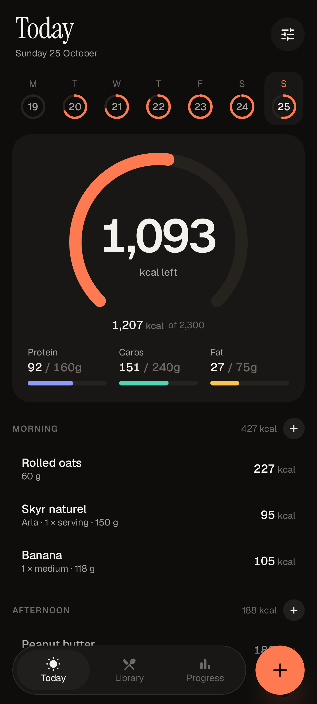
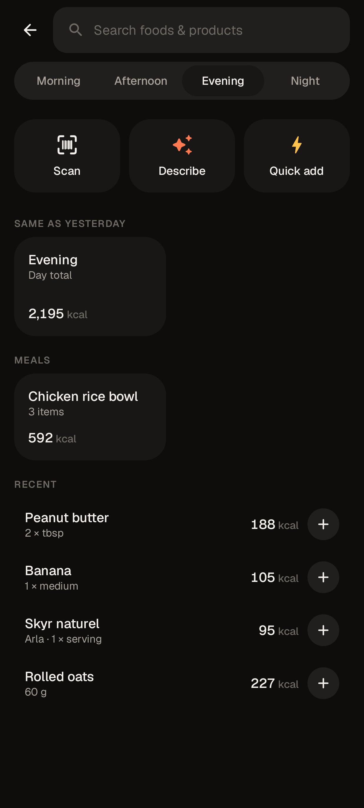
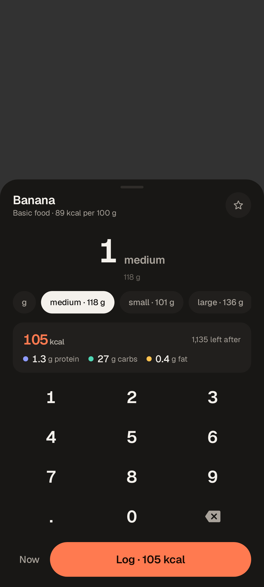
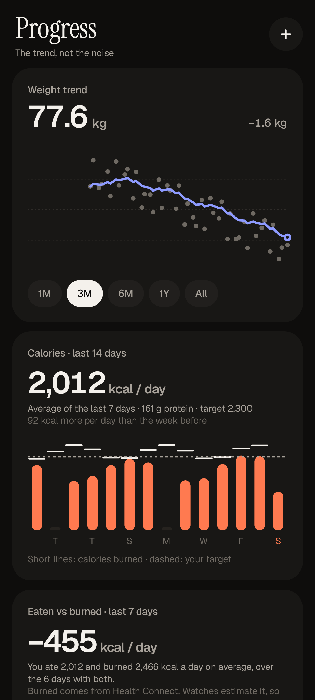

# Tare

A fast, calm calorie tracker for Android. Log food in seconds and see only what matters.

<p>
  
  
  
  
</p>

- **One-tap re-logging** of anything you've eaten before, favourites, saved meals you can
  scale, and "same as yesterday" for whole mornings or days.
- **Your own portions**: save "my bowl = 350 g" once, then it's one tap.
- **Barcode scanning** with Open Food Facts, strongest on Dutch supermarket products, with
  "Log & next" for meals built from several packages.
- **Thousands of basic foods offline** (USDA), searchable in Dutch and English.
- **Describe a meal or snap a photo** and Claude turns it into editable items, reusing your
  usual foods when it recognises them. Share a photo from the gallery to Tare to do the same.
- **Recipes by cooked weight**, so a portion of the pot is exact.
- **Weight trend** that smooths out daily water swings, and a week-over-week intake glance.
- **Launcher shortcuts** (long-press the icon): scan, describe, log.
- Local-first, with a **daily automatic backup** to a folder you choose.

## Install on your phone

Releases are built and signed by CI on every merge to `main`.

1. Install [Obtainium](https://github.com/ImranR98/Obtainium).
2. The repository is private, so create a GitHub fine-grained token with **read-only Contents**
   access to `Borisvdk/tare`, and add it in Obtainium → Settings → GitHub token.
3. Add app → `https://github.com/Borisvdk/tare`. Obtainium installs the latest
   `tare-<version>.apk` and updates it from then on.

To use Describe and label reading, add a Claude API key in Tare → Settings → Claude, which
walks through it: Claude Max includes monthly API credits (claim them on claude.ai →
Settings → Billing → API credits, linking a Console organization), then create a key at
[platform.claude.com](https://platform.claude.com/settings/keys) and paste it. Tare checks the
key before saving it. It is encrypted on the device and never included in backups.

Then turn on **Settings → Data → Back up daily to a folder** and pick a folder that syncs
(Google Drive, for example). Your diary only lives on the phone otherwise.

## Develop

Requirements: Android SDK (with `platforms;android-37`), JDK 17+ (Android Studio's bundled
JBR works), Git Bash on Windows.

```bash
scripts/dev.sh test       # unit, Robolectric and screenshot-render tests
scripts/dev.sh shots      # render screenshots into app/src/test/screenshots
scripts/dev.sh emulator   # boot the Android 16 emulator
scripts/dev.sh install    # build, install and launch the debug app
```

Coding agents: start with [CLAUDE.md](CLAUDE.md). Product and design are described in
[docs/](docs/).

## Data and licences

- Product data © Open Food Facts contributors, [ODbL](https://opendatacommons.org/licenses/odbl/1-0/).
- Basic foods: USDA FoodData Central SR Legacy (public domain), built by
  `tools/generic-foods/build.py`.
- Fonts: Geist and Instrument Serif, SIL Open Font License (`licenses/`).
